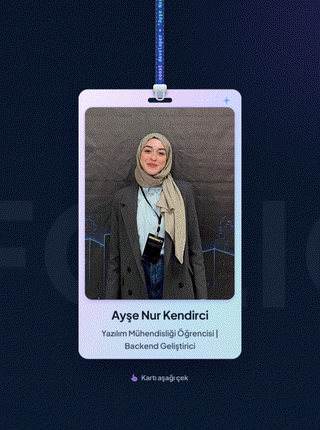

<div align="center">

# Ayşe Nur Kendirci — Portfolio

**Software Engineering student · Full-stack, with a stronger focus on the backend**

### 🔗 [aysenurkendirci.github.io/aysenur-portfolio](https://aysenurkendirci.github.io/aysenur-portfolio/)

[](https://aysenurkendirci.github.io/aysenur-portfolio/)


[**Visit the live site →**](https://aysenurkendirci.github.io/aysenur-portfolio/) · [Türkçe ↓](#türkçe)


</div>

## About

This is the personal portfolio of Ayşe Nur Kendirci, a Software Engineering student at Doğuş University. It presents her internships at VakıfBank and İncehesap.com & Oksid Bilişim, her projects, tech stack and certificates, in Turkish and English.

The site is built without a framework. One data file holds all the content, and a small Node script turns it into a single static page.

## Highlights



**An ID badge you can pull.** The hero photo hangs on a lanyard like a conference badge. Pull it down and let go: it springs back like a retractable badge reel. On phones, a tap does the same.

**Page-turn navigation.** Navbar links open each section with a book page turning over.

**A palette taken from code.** The purple, blue and green of `const developer = "Ayşe Nur Kendirci";` in the navbar color the whole site.

**Looks the same on every screen.** Hero sizes follow both the width and the height of the screen, so it keeps the same proportions from a 1366×768 laptop to a 2560×1440 monitor and always fits the first screen.

**No jumps while loading.** The page is generated in Turkish, the default language, and a size-matched fallback font is shown until the web font arrives. Layout shift (CLS) stays far below Google's 0.1 limit.

**Bilingual, two themes, accessible.** Turkish/English and dark/light switches, visible keyboard focus, WCAG AA contrast, and every animation turned off when "reduce motion" is on.

<br clear="right">

## Tech stack

| Area | Tools |
|---|---|
| Site | HTML, CSS, vanilla JavaScript |
| Build | Node.js script that renders `src/` into `index.html` |
| Tests | Node test runner + `puppeteer-core` (uses the Chrome or Edge already installed) |
| Fonts and icons | Plus Jakarta Sans, Fira Code, Font Awesome, Devicon |
| Hosting | GitHub Pages; Netlify configuration included |

## Getting started

Requirements: Node.js 18 or newer. Chrome or Edge is needed only for the browser tests.

```bash
npm install        # installs the test dependency (puppeteer-core)
npm run build      # validates src/data.json and generates index.html
npm run preview    # serves the site at http://127.0.0.1:5500
npm test           # build + all unit and browser tests
```

If Chrome is not in a standard location: `CHROME_PATH="/path/to/chrome" npm test`

## Updating content

1. Edit `src/data.json`. Every text has an `en` and a `tr` version.
2. Run `npm test`. It regenerates `index.html` and checks the result.
3. Commit `src/data.json` together with the regenerated `index.html`.

The build stops with a clear message if the data contains a missing translation, a phone number, HTML or template syntax, a non-https or unknown link, a file path outside the project, a missing file, an invalid email or icon class, or a duplicate project title.

## Project structure

```
├── index.html               # generated by build.js (do not edit by hand)
├── build.js                 # template engine + build (HTML-escapes every value)
├── src/
│   ├── data.json            # all site content, in Turkish and English
│   ├── template.html        # page shell (head, CSP, fonts, scripts)
│   └── components/          # navbar, hero, about, skills, experience, projects, certificates, contact, footer
├── css/
│   ├── base.css, navbar.css, hero.css, content.css   # original styles (unused rules commented out)
│   ├── sections.css         # sections, palette, animations, page turn, cursor, mobile navbar
│   └── hero-fx.css          # fonts, screen-proportional hero, lanyard and badge
├── js/
│   ├── init.js              # applies saved theme/language before first paint
│   ├── script.js            # language, theme, menu, page turn, reveals, email, cursor
│   └── hero-fx.js           # name intro and the pull-and-release badge physics
├── scripts/
│   ├── validate-data.js     # data.json checks, run on every build
│   └── serve.js             # local preview server
├── tests/
│   ├── validation.test.js   # validation, escaping and build output
│   └── site.test.js         # browser tests in real Chrome
├── images/                  # profile photo, CV (PDF), favicon
├── docs/                    # README images
└── netlify.toml             # build command, security headers, cache rules
```

## Tests

`npm test` runs unit tests and browser tests in real Chrome. They check that:

- the page never scrolls sideways, at 11 widths from 320px to 1920px, in both themes and both languages
- the hero fits the first screen and keeps the same proportions on six desktop sizes
- the mobile navbar stays on one row, under 70px, and the name is never cut off
- every navbar link reaches its section through the page-turn transition
- the mobile menu opens, and closes on a link, on Escape and on an outside tap
- language and theme switches work, and nothing flashes on reload
- layout shift stays under 0.1 on desktop and mobile, even on a slow connection
- the site keeps working when storage is blocked or holds tampered values
- with "reduce motion", everything is visible and nothing animates
- visible text meets WCAG AA contrast (4.5:1) in both themes
- the badge pulls down, springs back and stays still when idle
- the email fits on phones, opens a compose window and can be copied
- the CV downloads as a PDF, the favicon loads, and images, buttons and links are accessible

## Security

- Every value from `data.json` is HTML-escaped, so it cannot inject markup or be re-read as template syntax.
- The Content Security Policy allows only the site's own scripts: no inline scripts, no `eval`.
- CDN stylesheets are pinned to exact versions and checked with Subresource Integrity.
- `netlify.toml` adds HSTS, `frame-ancestors 'none'` and other security headers, and stops source files from being served.
- Language and theme values read from storage are accepted only from an allow-list.

## Deployment

- **GitHub Pages** serves the committed `index.html` from `main`, so run `npm test` before committing.
- **Netlify** runs `node build.js` on every deploy and stops the deploy if validation fails.

## License and contact

All personal content in this repository (text, photo, CV) belongs to Ayşe Nur Kendirci and may not be reused without permission.

[LinkedIn](https://www.linkedin.com/in/aysenurkendirci) · [GitHub](https://github.com/aysenurkendirci) · [Portfolio](https://aysenurkendirci.github.io/aysenur-portfolio/)

---

## Türkçe

### 🔗 Canlı site: [aysenurkendirci.github.io/aysenur-portfolio](https://aysenurkendirci.github.io/aysenur-portfolio/)

Doğuş Üniversitesi Yazılım Mühendisliği öğrencisi Ayşe Nur Kendirci'nin kişisel portfolyo sitesi. Full-stack çalışıyor, ağırlığı backend tarafında. Sitede VakıfBank ile İncehesap.com & Oksid Bilişim stajları, projeleri, kullandığı teknolojiler ve sertifikaları Türkçe ve İngilizce olarak yer alıyor.

Site framework kullanmadan yapıldı. Tüm içerik tek bir veri dosyasında duruyor; küçük bir Node scripti bunu tek bir statik sayfaya dönüştürüyor.

### Öne çıkanlar

- **Çekilebilen yaka kartı.** Hero'daki fotoğraf, bir etkinlik yaka kartı gibi askıda duruyor. Kartı aşağı çekip bırakınca makaralı askılar gibi yaylanarak yerine dönüyor. Telefonda dokunmak yeterli.
- **Kitap sayfası geçişi.** Menüden bir bölüme gidilince sayfa çevrilerek açılıyor.
- **Koddan gelen palet.** Navbar'daki `const developer = "Ayşe Nur Kendirci";` satırının mor, mavi ve yeşil renkleri tüm siteyi renklendiriyor.
- **Her ekranda aynı görünüm.** Hero'nun boyutları ekranın hem genişliğine hem yüksekliğine göre ayarlanıyor. 1366×768 dizüstüden 2560×1440 monitöre kadar aynı oranda görünüyor ve ilk ekrana sığıyor.
- **Yüklenirken kayma yok.** Sayfa varsayılan dil olan Türkçe ile üretiliyor ve web fontu gelene kadar ölçüleri ona eşitlenmiş bir yedek font gösteriliyor. Yükleme kayması (CLS), Google'ın 0.1 sınırının çok altında.
- **İki dil, iki tema, erişilebilir.** Türkçe/İngilizce ve koyu/açık tema, görünür klavye odağı, WCAG AA kontrastı. "Hareketi azalt" açıkken tüm animasyonlar kapanıyor.

### Kurulum

Gereksinim: Node.js 18 veya üstü. Tarayıcı testleri için Chrome ya da Edge gerekir.

```bash
npm install        # test bağımlılığını kurar (puppeteer-core)
npm run build      # src/data.json'u doğrular ve index.html'i üretir
npm run preview    # siteyi http://127.0.0.1:5500 adresinde açar
npm test           # derleme + tüm birim ve tarayıcı testleri
```

### İçerik güncelleme

1. `src/data.json` dosyasını düzenle. Her metnin `en` ve `tr` karşılığı var.
2. `npm test` çalıştır. `index.html` yeniden üretilir ve kontrol edilir.
3. `src/data.json` ile yeniden üretilen `index.html` dosyasını birlikte commit et.

Veride eksik çeviri, telefon numarası, HTML veya şablon ifadesi, `https` olmayan ya da tanınmayan bir link, proje dışına çıkan ya da var olmayan bir dosya, geçersiz e-posta veya ikon sınıfı ya da tekrar eden bir proje başlığı varsa derleme açık bir mesajla durur.

### Testler

`npm test`, birim testlerini ve gerçek Chrome'da çalışan tarayıcı testlerini çalıştırır. Kontrol edilenler:

- 320px'ten 1920px'e 11 genişlikte, iki temada ve iki dilde sayfa hiçbir zaman yana kaymıyor
- hero altı masaüstü boyutunda ilk ekrana sığıyor ve aynı oranda görünüyor
- mobil navbar tek satırda, 70px'in altında ve isim hiçbir genişlikte kesilmiyor
- menüdeki her link, sayfa çevirme geçişiyle doğru bölüme gidiyor
- mobil menü açılıyor; linke tıklayınca, Escape'e basınca ve dışarı dokununca kapanıyor
- dil ve tema düğmeleri çalışıyor, yeniden yüklemede hiçbir şey yanıp sönmüyor
- yükleme kayması masaüstünde ve telefonda, yavaş bağlantıda bile 0.1'in altında
- depolama engelliyken ya da depoda bozuk değerler varken site çalışmaya devam ediyor
- "hareketi azalt" modunda her şey görünür ve hiçbir şey hareket etmiyor
- ekrandaki metinler iki temada da WCAG AA kontrastını (4.5:1) sağlıyor
- kart aşağı çekiliyor, yaylanarak dönüyor ve boştayken hareketsiz kalıyor
- e-posta telefonda taşmıyor, yazma ekranını açıyor ve kopyalanabiliyor
- CV PDF olarak iniyor, favicon yükleniyor; görseller, düğmeler ve linkler erişilebilir

### Güvenlik

- `data.json`'daki her değer HTML kaçışından geçer; sayfaya kod sokulamaz, değerler şablon olarak yeniden okunamaz.
- İçerik Güvenlik Politikası (CSP) yalnızca sitenin kendi scriptlerine izin verir; satır içi script ve `eval` yasaktır.
- CDN stil dosyaları sabit sürüme bağlıdır ve SRI ile doğrulanır.
- `netlify.toml` HSTS, `frame-ancestors 'none'` ve diğer güvenlik başlıklarını ekler, kaynak dosyaların sunulmasını engeller.
- Depodan okunan dil ve tema değerleri yalnızca izin listesindeyse kullanılır.

### Yayınlama

- **GitHub Pages**, `main` dalındaki commit edilmiş `index.html` dosyasını yayınlar. Bu yüzden commit'ten önce `npm test` çalıştır.
- **Netlify** her yayında `node build.js` çalıştırır; doğrulama başarısız olursa yayın durur.

### Lisans ve iletişim

Bu repodaki kişisel içerik (metinler, fotoğraf, CV) Ayşe Nur Kendirci'ye aittir; izinsiz kullanılamaz.

[LinkedIn](https://www.linkedin.com/in/aysenurkendirci) · [GitHub](https://github.com/aysenurkendirci) · [Portfolyo](https://aysenurkendirci.github.io/aysenur-portfolio/)
