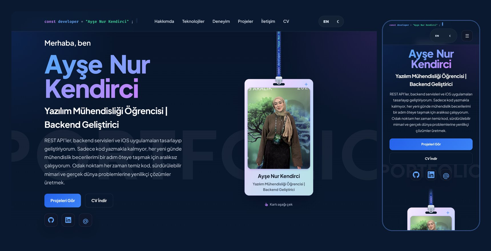

# Ayşe Nur Kendirci — Portfolio

**Live site:** https://aysenurkendirci.github.io/aysenur-portfolio/

Personal portfolio of Ayşe Nur Kendirci, a Software Engineering student at Doğuş University who works full-stack with a stronger focus on the backend. The site presents her internships (VakıfBank, İncehesap.com & Oksid Bilişim), projects, tech stack and certificates in Turkish and English.



[Türkçe açıklama aşağıda ↓](#türkçe)

---

## Highlights

- **Interactive ID badge.** The hero photo hangs on a lanyard like a conference badge. Pull it down and let go: it springs back like a retractable badge reel. On touch screens, a tap does the same.
- **Page-turn navigation.** Navbar links open each section with a book page turning over.
- **Bilingual and themed.** Turkish/English and dark/light switches. The saved choice is applied before the first paint, so the page never flashes the wrong theme or language.
- **Palette from the code line.** The purple, blue and green of `const developer = "Ayşe Nur Kendirci";` in the navbar are used across the whole site.
- **Accessible motion.** Every animation is disabled when the system "reduce motion" setting is on. Content stays visible without JavaScript.
- **No framework.** Plain HTML, CSS and JavaScript, generated from a single data file by a small Node build script.

## Tech stack

| Area | Tools |
|---|---|
| Site | HTML, CSS, vanilla JavaScript |
| Build | Node.js script that renders `src/` into `index.html` |
| Tests | Node test runner + `puppeteer-core` (uses the Chrome or Edge already installed) |
| Fonts and icons | Plus Jakarta Sans, Fira Code, Font Awesome, Devicon |
| Hosting | GitHub Pages; Netlify configuration included |

## Getting started

Requirements: Node.js 18 or newer. Chrome or Edge is needed only for the browser tests.

```bash
npm install        # installs the test dependency (puppeteer-core)
npm run build      # validates src/data.json and generates index.html
npm run preview    # serves the site at http://127.0.0.1:5500
npm test           # build + 28 unit and browser tests
```

If Chrome is not in a standard location, point the tests to it:
`CHROME_PATH="/path/to/chrome" npm test`

## Project structure

```
├── index.html               # generated by build.js (do not edit by hand)
├── build.js                 # template engine + build (HTML-escapes every value)
├── src/
│   ├── data.json            # all site content, in Turkish and English
│   ├── template.html        # page shell (head, CSP, fonts, scripts)
│   └── components/          # navbar, hero, about, skills, experience, projects, certificates, contact, footer
├── css/
│   ├── base.css, navbar.css, hero.css, content.css   # original styles (unused rules are commented out)
│   ├── sections.css         # section design, palette, animations, page turn, cursor
│   └── hero-fx.css          # fonts, hero intro, lanyard and badge
├── js/
│   ├── init.js              # applies saved theme/language before first paint
│   ├── script.js            # language, theme, mobile menu, page turn, reveals, cursor
│   └── hero-fx.js           # name intro and the pull-and-release badge physics
├── scripts/
│   ├── validate-data.js     # data.json checks, run on every build
│   └── serve.js             # local preview server
├── tests/
│   ├── validation.test.js   # validation and escaping unit tests
│   └── site.test.js         # browser tests in real Chrome
├── images/                  # profile photo, CV (PDF), favicon
├── docs/preview.jpg         # README screenshot
└── netlify.toml             # build command, security headers, cache rules
```

## Updating content

1. Edit `src/data.json`. Every text has an `en` and a `tr` version.
2. Run `npm test`. It regenerates `index.html` and checks the result.
3. Commit both `src/data.json` and the regenerated `index.html`.

The build stops with a clear message if the data contains:

- a missing translation or empty field
- a phone number (personal data must not be published)
- HTML, template syntax or `javascript:` in any text
- a link that is not `https` or not on GitHub/LinkedIn
- a file path outside the project, or a file that does not exist
- an invalid email, icon class or duplicate project title

## Tests

`npm test` runs 28 tests. The browser tests open the real page in Chrome and check that:

- the page never scrolls sideways, at 11 widths from 320px to 1920px, in both themes and both languages
- every navbar link reaches its section through the page-turn transition
- the mobile menu opens, and closes on a link, on Escape and on an outside tap
- the language and theme switches work, and the theme does not flash on reload
- the site keeps working when storage is blocked or holds tampered values
- with "reduce motion", everything is visible and nothing animates
- the visible text meets WCAG AA contrast (4.5:1) in both themes, including the mobile menu
- the badge pulls down, springs back and stays still when idle
- the CV downloads as a PDF, the favicon loads, and images, buttons and links are accessible

## Security

- Every value from `data.json` is HTML-escaped. Values cannot inject markup or be re-read as template syntax.
- The Content Security Policy allows only the site's own scripts: no inline scripts, no `eval`.
- CDN stylesheets are pinned to exact versions and checked with Subresource Integrity.
- `netlify.toml` adds HSTS, `frame-ancestors 'none'`, `nosniff`, a referrer policy and a permissions policy, and stops `src/`, `scripts/`, `tests/` and the build files from being served.
- Language and theme values read from storage are accepted only from an allow-list.

## Deployment

- **GitHub Pages** serves the committed `index.html` from `main`, so always run `npm run build` (or `npm test`) before committing.
- **Netlify** runs `node build.js` on every deploy. If validation fails, the deploy stops.

## License

All personal content in this repository (text, photo, CV) belongs to Ayşe Nur Kendirci and may not be reused without permission.

## Contact

- LinkedIn: [linkedin.com/in/aysenurkendirci](https://www.linkedin.com/in/aysenurkendirci)
- GitHub: [github.com/aysenurkendirci](https://github.com/aysenurkendirci)

---

## Türkçe

**Canlı site:** https://aysenurkendirci.github.io/aysenur-portfolio/

Doğuş Üniversitesi Yazılım Mühendisliği öğrencisi Ayşe Nur Kendirci'nin kişisel portfolyo sitesi. Full-stack çalışıyor, ağırlığı backend tarafında. Sitede stajları (VakıfBank, İncehesap.com & Oksid Bilişim), projeleri, kullandığı teknolojiler ve sertifikaları Türkçe ve İngilizce olarak yer alıyor.

### Öne çıkanlar

- **Etkileşimli yaka kartı.** Hero'daki fotoğraf, bir etkinlik yaka kartı gibi askıda duruyor. Kartı aşağı çekip bırakınca makaralı askılar gibi yaylanarak yerine dönüyor. Telefonda dokunmak yeterli.
- **Kitap sayfası geçişi.** Menüden bir bölüme gidilince sayfa çevrilerek açılıyor.
- **İki dil, iki tema.** Türkçe/İngilizce ve koyu/açık tema. Seçim sayfa çizilmeden önce uygulandığı için ekran yanıp sönmüyor.
- **Koddan gelen palet.** Navbar'daki `const developer = "Ayşe Nur Kendirci";` satırının mor, mavi ve yeşil renkleri tüm sitede kullanılıyor.
- **Erişilebilir hareket.** Sistemde "hareketi azalt" açıksa tüm animasyonlar kapanıyor. JavaScript olmadan da içerik görünür kalıyor.
- **Framework yok.** Sade HTML, CSS ve JavaScript. Tek bir veri dosyasından küçük bir Node scripti ile üretiliyor.

### Kurulum

Gereksinim: Node.js 18 veya üstü. Tarayıcı testleri için Chrome ya da Edge gerekir.

```bash
npm install        # test bağımlılığını kurar (puppeteer-core)
npm run build      # src/data.json'u doğrular ve index.html'i üretir
npm run preview    # siteyi http://127.0.0.1:5500 adresinde açar
npm test           # derleme + 28 birim ve tarayıcı testi
```

### İçerik güncelleme

1. `src/data.json` dosyasını düzenle. Her metnin `en` ve `tr` karşılığı var.
2. `npm test` çalıştır. `index.html` yeniden üretilir ve kontrol edilir.
3. `src/data.json` ile yeniden üretilen `index.html` dosyasını birlikte commit et.

Veride şunlardan biri varsa derleme açık bir mesajla durur:

- eksik çeviri veya boş alan
- telefon numarası (kişisel bilgi yayınlanmamalı)
- herhangi bir metinde HTML, şablon ifadesi veya `javascript:`
- `https` olmayan ya da GitHub/LinkedIn dışına giden link
- proje dışına çıkan ya da var olmayan dosya yolu
- geçersiz e-posta, ikon sınıfı veya aynı proje başlığının tekrarı

### Testler

`npm test` 28 test çalıştırır. Tarayıcı testleri sayfayı gerçek Chrome'da açar ve şunları kontrol eder:

- 320px'ten 1920px'e 11 ekran genişliğinde, iki temada ve iki dilde sayfa hiçbir zaman yana kaymıyor
- menüdeki her link, sayfa çevirme geçişiyle doğru bölüme gidiyor
- mobil menü açılıyor; linke tıklayınca, Escape'e basınca ve dışarı dokununca kapanıyor
- dil ve tema düğmeleri çalışıyor, tema yeniden yüklemede yanıp sönmüyor
- depolama engelliyken ya da depoda bozuk değerler varken site çalışmaya devam ediyor
- "hareketi azalt" modunda her şey görünür ve hiçbir şey hareket etmiyor
- ekrandaki metinler iki temada da WCAG AA kontrastını (4.5:1) sağlıyor, mobil menü dahil
- kart aşağı çekiliyor, yaylanarak dönüyor ve boştayken hareketsiz kalıyor
- CV PDF olarak iniyor, favicon yükleniyor; görseller, düğmeler ve linkler erişilebilir

### Güvenlik

- `data.json`'daki her değer HTML kaçışından geçer; sayfaya kod sokulamaz, değerler şablon olarak yeniden okunamaz.
- İçerik Güvenlik Politikası (CSP) yalnızca sitenin kendi scriptlerine izin verir; satır içi script ve `eval` yasaktır.
- CDN stil dosyaları sabit sürüme bağlıdır ve SRI ile doğrulanır.
- `netlify.toml` HSTS, `frame-ancestors 'none'` ve diğer güvenlik başlıklarını ekler. `src/`, `scripts/`, `tests/` ve derleme dosyalarının dışarıya sunulmasını engeller.
- Depodan okunan dil ve tema değerleri yalnızca izin listesindeyse kullanılır.

### Yayınlama

- **GitHub Pages**, `main` dalındaki commit edilmiş `index.html` dosyasını yayınlar. Bu yüzden commit'ten önce mutlaka `npm run build` (veya `npm test`) çalıştır.
- **Netlify** her yayında `node build.js` çalıştırır; doğrulama başarısız olursa yayın durur.

### Lisans

Bu repodaki kişisel içerik (metinler, fotoğraf, CV) Ayşe Nur Kendirci'ye aittir; izinsiz kullanılamaz.
